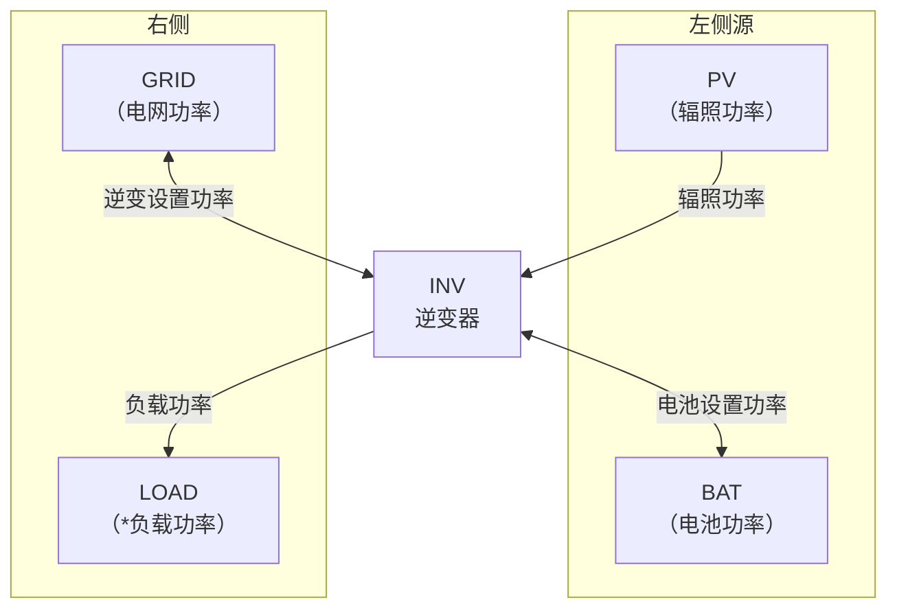

# 参考光储逆变器产品，创建个光储一体机（混逆）模型，用于功率控制和数据仿真

## 硬件拓扑图

## 光储并网系统功率流向框图

- 2个控制接口电池设置功率和逆变设置功率
- 逆变口功率=光伏发电+电池功率
- 电池根据TOU控制逻辑充电/放电
- 电池和光伏采用直流母线并联发电
- 电池口可以根据TOU设置充电/放电功率
- 负载功率可以从逆变口取电，不足时从电网取电

## 功率流向说明

| 路径             | 方向 | 说明                     |
| -------------- | -- | ---------------------- |
| PV → INV       | 单向 | 光伏辐照功率输入逆变器            |
| BAT ↔ INV      | 双向 | 电池充放电，由"电池设置功率"控制      |
| INV → GRID（电网） | 双向 | 逆变设置功率馈入电网,负载或者电网从逆变取电 |
| INV → LOAD（负载） | 单向 | 逆变设置功率供给本地负载           |
## 定义
- TOU是指设定电池端功率的计划，而不是逆变器端功率，这点与PCS不同
- TOU充放电限制： Pchar_grid≤Ptou；Pdisc_bat≤Ptou
- TOU放电目标是尽量满足TOU放电计划
  - 会被负载或者防逆流开关，间接调整逆变口限制影响
  - 会被光伏发电功率影响，受限于逆变额定功率
- TOU充电目标是电池从电网取电功率
  - 会被取电功率影响，间接影响逆变口限制功率
  - 会被光伏发电功率影响，受限于逆变额定功率

## 硬件要求
- 1倍额定功率125kw
- PV支持2倍光伏超配，2倍额定功率
- 储能和逆变器口是1倍额定功率
- 逆变设置功率是限制功率，当光伏和电池不能满足工况时，逆变设置功率=光伏+电池功率
## 控制优先级

- SOC过上下限时触发保护动作时电池功率清零
- 负载取电优先级》光伏 》电池 》电网
- 电池充电优先级》光伏 》电网
- 馈网电能优先级》光伏 》电池
- 光伏发电供给优先级 》负载 》电网 》电池

## EMS混逆执行策略

- 馈网功率是正数代表向电网卖电，例子我们设定70 kW，设置0 kW代表启动防逆流，系统约束的对电网卖电功率，并非目标值
- 取电功率限制，逆变器设置充电功率+负载用电功率不能超过电网最大取电功率，我们设定100 kW，设置0 kW代表不从电网取电。系统约束尽量小从电网取电，并非目标值
- TOU放电时不会突破计划放电功率限制，光伏有发电功率 + 电池功率上升达到1倍额定功率，减小电池发电功率，甚至反转为充电
- TOU充/放/待机光伏消纳优先级大于策略中储能TOU计划的优先级，光伏消耗不掉能量会减少TOU储能计划放电，甚至反转为充电，最大充电功率为1倍额定功率
- TOU充电计划功率和取电功率优先保证取电功率，超过取电功率时，充电计划功率会减少，保证不超取电上限，超限时先降充电计划，取电随之下降。
- TOU充电时，在取电功率允许情况下，可以从电网取电，保证电池设置功率按照计划功率执行
- TOU充电时，光伏充足时，优先供负载，余电按馈网设定先馈网（≤馈网上限），超出馈网上限或防逆流时再对储能充电
- 负载>取电功率时，TOU不会突破TOU设置计划放电功率
- TOU充电时，设置逆变口限制功率是充电，逆变器不能翻转为放电，若光伏辐照强，只能用光伏对电池充电，逆变口无法转为放电，需要翻转逆变口充电功率为放电（**注意：不能自动调整逆变口充电方向为放电方向，无法按照计划充电执行**）

## 行为约定
### 原则（电池尽量满足TOU）
- 应放尽放，尽量保证电池按照TOU计划执行，除非光伏+电池达到额定功率，被迫减小电池发电功率
- 光伏优先，负载尽量用光伏，有光伏时减少逆变从市电取电，直至转为放电方向；尽量保证电池按照TOU计划执行，除非由于防逆流等无法放电，被迫增加电池充电功率，直至达到电池额定充电功率
- 光伏上升，多余能量优先增加电池充电功率，光伏充裕DSP优先上调电池口功率消纳光伏，ARM调整逆变口放开限制
- 光伏不足，优先减少口实际逆变口输出功率，尽量保证电池放电功率

### ARM(EMS)行为
- ARM下发电池SOC范围到DSP
- ARM在实际执行逆变放电时，根据负载结合防逆流和溃网功率限制，调整逆变口限制功率
- ARM在实际执行逆变充电时，根据负载结合取电功率限制，调整逆变口限制功率
- ARM在TOU计划充电中，设置逆变口限制充电功率；当光伏功率>计划功率时，电池功率突破计划充电功率，ARM反转逆变功率为放电方向，并且设定逆变口放电功率=MIN（光伏剩余可发电功率，允许发电功率）；光伏剩余可发电功率 = 光伏-计划充电功率；允许发电功率 = 负载 + 溃网功率

#### 扰动法独有行为（限制PV发电在DSP,ARM负责增加发电量但没有依据）
- 电池口物理限制功率比1倍额定功率略大，留一定扰动控制余量，扰动可能会导致电池口功率在一定范围内抖动和光伏功率爬升略慢；
- 实际电池功率 < 计划充电功率/待机0功率：增加混逆发电功率；反之减小混逆发电功率，甚至充电。（充电功率负充正放）
- 实际电池功率 > 计划放电功率：减少混逆发电功率，反之增加混逆发电功率。

- 所有时间段内提前充满，ARM在TOU计划内标识临时禁充，防止电池过充，令EMS电池控制目标值=0功率。
- 放电时间段内提前放空，ARM在TOU计划内标识临时禁充，防止电池过充，令EMS电池控制目标值=0功率。

> 注意：由于光伏，或者电池本身具有数据突然改变的可能，所有有线性和离散2段空间，逆变口设定功率P_INV_SET = P_PV + （P_PLAN）。 稳态时逆变口实际功率P_INV = P_PV + P_BAT；在反馈控制失效后，目标功率P_INV != P_INV_SET，在TOU计划内标识临时禁充/禁放，需要重新调整P_INV_SET = P_PV + 电池当前功率 + 扰动功率 ，在下个充放前清除标记。存在短暂的功率错误无法避免。
> 问题：逆变口会让放电曲线部分时间都处于扰动状态

#### 限制电池放电法独有行为（限制PV发电在DSP，放开发电也在DSP）
- 在放电时间段写入电池限制放电功率=TOU计划放电数值，ARM不管电池侧放电功率，仅仅控制逆变口放电功率；其他时间段电池限制放电功率设置=0
- 所有时间段内提前充满，ARM在TOU计划内标识临时禁充，防止电池过充，令EMS电池控制目标值=0功率。
- 放电时间段内提前放空，ARM在TOU计划内标识临时禁充，防止电池过充，令DSP限制放电功率=0功率。
> 问题：电池放电功率限制寄存器需要增加，不适合三方混逆控制

### DSP行为
- DSP根据电池SOC范围，保护电池停止充电/放电
- DSP支持逆变器限制功率，放电方向：直流向交流逆变；充电方向：交流向直流电池充电
  - 放电方向：如果光伏不足或者电池无法放电，逆变器下调输出功率，直至0功率
  - 充电方向：如果电池无法充电，逆变器下调实际取电功率，直至0功率
- DSP在逆变口为放电过程中，电池口设定为限制放电功率时，光伏发电上升导致超过逆变设定放电功率（最大不超过1倍额定功率），会下降电池放电功率，电池给充电方向。
- DSP无法满足分相控制A/B/C功率时，按照3相等差输出下调实际逆变执行功率，保证分相不平衡控制

## 绘制曲线图要求

调用混逆模型仿真实现TOU控制逻辑（充50/放50/待机；负充正放），需要考虑到上文中的EMS策略可能性
测试以下工况，并且用matplotlib.pyplot 记录测试结果，并且产生测试文档。
### 第一张图绘制内容,目标执行效果

描述执行策略时全部工况，负载功率/电网功率/电池功率/光伏辐照功率/TOU计划功率/逆变功率

### 第二张图绘制内容，EMS通过限制BDC功率方法
- TOU赋值计算公式，绘制数据：光伏功率/电网功率/电池功率/TOU计划功率/逆变设置功率/逆变实际功率/电池放电限制功率/充满放空标识
  - 充电
    - 逆变设置功率（限制功率）= 闭环调整逆变设置功率满足充电功率，当触发约束条件后，光伏功率自动用电池消纳
    - 电池限制功率 = 0
  - 待机
    - 逆变设置功率（限制功率）= 闭环调整逆变设置功率，目标是电池口功率=0，当触发约束条件后，光伏功率自动用电池消纳
    - 电池限制功率 = 0
  - 放电（DSP闭环控制）
    - 逆变设置功率（限制功率）=馈电功率+负载功率
    - 电池限制功率 = TOU计划功率

## 寄存器定义
### 60混逆当前
- 电池设定功率和设定逆变口功率不可同时设定
- TOU放电工况
  - 43712：限制逆变器最大值，跟随负载+溃网功率
  - 43754：限制电池放电功率，放电时设置此寄存器=TOU，配合43712，否则设置无效值
- TOU充电/待机工况
  - 43746：逆变目标寄存器充电时，动态调整逆变此功率，目标尽量电池充电 = 计划，需要配合43754设置为无效值，43712解除限制

### 125混逆，修改意见
- 电池和逆变口可同时设定，冲突时电池是限制功率保证，逆变是目标功率
- TOU全部工况
  43746：逆变目标寄存器，动态调整逆变此功率, 充电时光伏功率上升，ARM控制目标功率下降直至0，然后翻转
- TOU放电工况特殊处理
  43754：限制电池放电功率，放电时设置此寄存器=TOU，其他设置无效
  
  